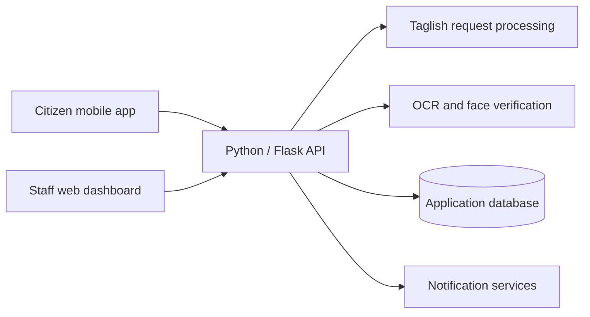

# Smart Mobile DocuProcessing Application for Barangay E-Governance

**A mobile-first approach to barangay document requests, with Taglish language processing and speech-to-text integration.**

Academic team thesis project · BS Computer Science · FEU Institute of Technology

> **Public project showcase.** This repository presents the system overview and technical approach. Application source code, credentials, and citizen records are not distributed here.

## The problem

Requesting barangay documents can involve repeated office visits, manual data entry, and limited visibility into request status. This project explores a mobile workflow for citizens and a web dashboard for barangay staff, designed around Barangay Santa Ana, Pateros.

## What the system does

Citizens can request Barangay Clearance and Certificate of Residency through a mobile application. The system combines natural-language input, identity verification, and a structured administrative review process.

| Capability | Purpose |
|---|---|
| Taglish document requests | Interpret Filipino-English requests and identify the document and purpose. |
| Voice input | Convert spoken requests into text for processing. |
| Guided clarification | Ask for missing or ambiguous request details before submission. |
| ID scanning and OCR | Assist with registration data entry from an identity document. |
| Face verification | Support identity checks during the request workflow. |
| Request tracking | Let citizens follow progress and receive updates. |
| Administrative dashboard | Help staff review requests, requirements, and document release. |
| Authorized pickup | Support representative pickup through an authorization workflow. |

## Request journey

1. Register and complete identity verification.
2. Enter or speak a document request.
3. Review the interpreted details and supply missing information.
4. Submit requirements and track the request.
5. Complete staff review and document pickup.

Staff can **Release**, **Require** additional information, **Hold**, **Redirect**, or **Escalate** a request.

## Architecture

The mobile interface, administrative dashboard, and processing services have separate responsibilities. The language-processing pipeline combines normalization, rule-based interpretation, fuzzy matching, and a classification fallback for uncertain requests.

## Technology stack

| Layer | Technologies |
|---|---|
| Mobile application | React Native, Expo, JavaScript, React Navigation, React Native Paper |
| API and backend | Python, Flask, SQLAlchemy |
| Data storage | SQLite, AsyncStorage for mobile local storage |
| Language processing | Custom parsing pipeline, RapidFuzz, classification integration |
| Image processing | OpenCV, OCR libraries, dlib / face-recognition |
| Authentication and updates | JWT-based authentication, Firebase messaging |

## Project context and credits

This is a collaborative academic project presented in **Ralph Abaya's portfolio**. The system represents the work of the thesis team; this showcase does not attribute all implementation to one member.

- **Ralph Abaya** — [GitHub profile](https://github.com/ralphabayaa)
- **Kyle Concepcion**
- **Patrick Gengania**
- **Guienne Reyes**

**Institution:** FEU Institute of Technology, BS Computer Science  
**Thesis adviser:** Mr. Hadji J. Tejuco

## Scope of this showcase

This page describes the project based on its implementation and documentation. It does not claim a production deployment or independently verified performance results. Source code remains outside this public repository.
